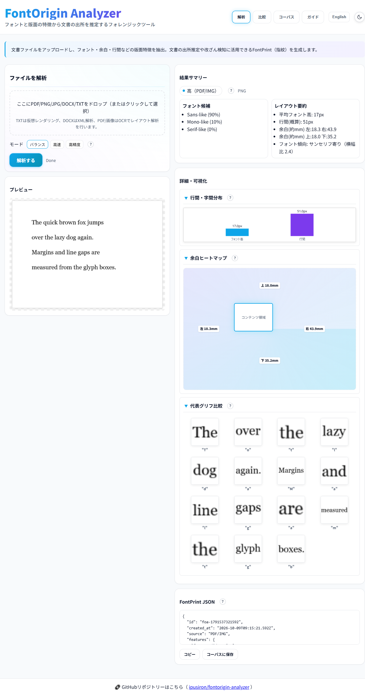

# FontOrigin Analyzer - Document Origin Forensics


[](https://ipusiron.github.io/fontorigin-analyzer/)

**Day090 - 100 Security Tools with Generative AI**

🌐 日本語README: **[README.md](README.md)** / You can switch the UI language (JA⇔EN) with the toggle in the top-right corner.

**FontOrigin Analyzer** extracts the *layout metrics* of a document — fonts, line spacing, margins, glyph shapes — and uses that fingerprint (a **FontPrint**) to estimate a document's **origin** and whether two documents match.

It runs entirely in the browser; files are analyzed locally and never uploaded, so you can try it safely while keeping your data private.

---

## 🌐 Demo

👉 **[https://ipusiron.github.io/fontorigin-analyzer/](https://ipusiron.github.io/fontorigin-analyzer/)**

---

## 📸 Screenshot

> 
> *Analysis of a PNG document, showing the margin heatmap, representative glyphs cropped from OCR, the font lean, and the FontPrint JSON.*

---

## 🧭 What makes this tool different

Unlike generic metadata extractors (such as exiftool) or font-identification services, FontOrigin Analyzer looks at the **rendered appearance**, not the file metadata.

- **Works even without metadata** — scans, screenshots and re-exported PDFs often lose their authoring metadata. This tool derives features from the look of the page (margins in mm, line gap in px, cropped glyph images), so it still gives you clues.
- **Fingerprints without uploading** — everything runs in the browser. Even for sensitive documents you can extract only the FontPrint and compare it locally.
- **Grow your own reference corpus** — save FontPrints from known templates and past documents, then match new documents against them with cosine similarity.
- **Compare *real* glyph images** — representative characters are cropped from the OCR bounding boxes, so you can see how the same "a" differs between typefaces (the goal is to notice shape differences, not to name the exact font).

---

## 🔍 Forensic & OSINT use

- **Tamper detection** — compare revisions of one document and spot edits from font/margin changes.
- **Origin / authoring forensics** — identify an organisation or template from margin ratios and line spacing.
- **Edit-chain reconstruction** — infer a Word→PDF→image chain from font changes.
- **Source reliability (OSINT)** — check whether a document claimed to be "official" matches the expected margins/fonts.
- **Disinformation / AI-generated check** — generated documents often have unnatural line spacing or font pairings.

> ⚠ Results are **clues for estimation**, not proof on their own. Combine several features and cross-check with other evidence.

---

## 🧩 Tabs

| Tab | What it does |
|:--|:--|
| **Analyze** | Upload a document, extract features, and build a FontPrint. Three OCR modes (balanced/fast/accurate); shows font candidates, a margin heatmap, representative glyphs and a line-gap chart; export JSON. |
| **Compare** | Load two files side by side and compare fonts, font height and line gap; cosine-similarity score. |
| **Corpus** | Save and manage FontPrints in `localStorage`; export/import JSON (import is schema-validated). |
| **Guide** | Supported formats, analysis modes, forensic/OSINT examples, and ethics notes. |

---

## 📂 Supported formats & confidence

| Format | Confidence | How it is analyzed |
|:--|:--|:--|
| PDF / PNG / JPG | **High** | OCR (Tesseract.js). Fixed layout, most accurate. |
| DOCX | **Medium** | Margins/fonts read from the XML. May differ from the real render. |
| TXT | **Low** | Virtual rendering. No real layout info, so results depend on the environment. |
| DOC | — | Not supported (binary). Convert to .docx or .pdf. |

---

## 🔒 Privacy & ethics

- 100% client-side; files are never sent to a server.
- The corpus is stored in `localStorage` (device only).
- Do not upload personal or confidential documents to the public demo.
- For education, research and demonstration only.

---

## 🛡️ Security notes

- **CSP** declared via a meta tag (GitHub Pages cannot set headers). `script-src` is limited to `'self' blob: 'wasm-unsafe-eval'` plus the two CDNs; `'unsafe-eval'` is not allowed.
- **SRI** (sha384) on all three CDN scripts.
- **Corpus import** is sanitized in `core.js` (`sanitizeFontPrint`) and rendered with DOM API + `textContent`, so a crafted JSON cannot inject script (stored-XSS defence).
- Headers that only work as HTTP response headers (`X-Frame-Options`, `X-Content-Type-Options`, `frame-ancestors`) are intentionally **not** declared in the meta tag. See [SECURITY.md](SECURITY.md).

---

## 🛠 Development

```bash
# No build step. Serve the folder and open it:
python -m http.server 8000   # then open http://localhost:8000

# Run the unit tests (pure logic + i18n parity):
npm test                     # node --test test/*.test.js
```

Technical details are in [ARCHITECTURE.md](ARCHITECTURE.md).

---

## 📄 License

MIT License — see [LICENSE](LICENSE).

---

## 🛠 About

Built as part of the "100 Security Tools with Generative AI" project.

🔗 [https://akademeia.info/?page_id=42163](https://akademeia.info/?page_id=42163)
